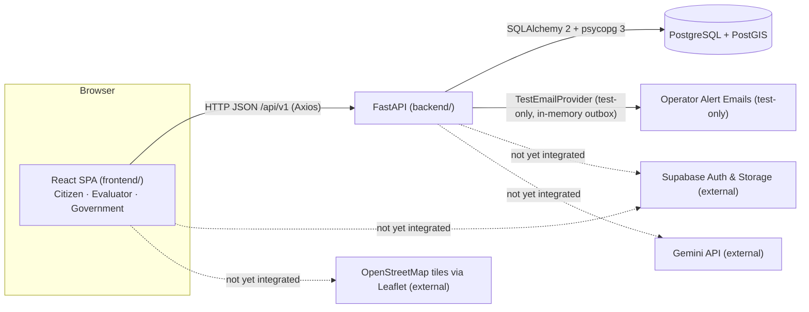

# Architecture

## Overview

There is one SPA and one API. All three role modules share them and the same database.

## Backend layout (`backend/app`)

| Path | Role |
|------|------|
| `main.py` | `create_app()`: settings, logging, CORS, error handlers, mounts `api_router` at `API_V1_PREFIX` |
| `core/config.py` | `Settings` (pydantic-settings) + cached `get_settings()` |
| `core/logging.py` | key=value log format |
| `core/security.py` | Auth stub (Shabaz) |
| `db/session.py` | Lazy engine, `SessionLocal`, `get_db()`, `check_database_connection()` |
| `db/base.py` | Declarative `Base` (Shubham owns all models) |
| `api/router.py` | Aggregates the v1 routers |
| `api/v1/*.py` | HTTP layer only: thin route functions |
| `modules/government/` | Government monitoring: `enums.py`, `domain.py` (read models), `interfaces.py` (protocols), `repositories/{memory,sql}.py`, `providers/{scores,email}.py`, `services/{facilities,overview,feedback,cleanliness,priority,issues,notifications}.py` (Ibrahim) |
| `modules/<domain>/` | Domain/business logic, called by routes |
| `modules/intelligence/` | AI, scoring, fraud, allocation and cooldown (Shubham) |
| `schemas/` | Pydantic request/response models (`common.py`, `government.py`) |

Rule: route handlers stay thin. They validate input, call `modules/*`, and return a schema.

## Frontend layout (`frontend/src`)

| Path | Role |
|------|------|
| `app/router.tsx` | All routes. Every page renders inside `AppShell`. |
| `app/layout/` | `AppShell` (header/nav/footer) and `ModuleShell` (module page wrapper) |
| `config/env.ts` | The only place that reads `import.meta.env` |
| `lib/api/` | Axios client, typed endpoint functions, and types mirroring backend schemas |
| `lib/supabase.ts` | Supabase stub (Shabaz) |
| `features/<module>/` | Module pages and components |
| `components/ui/` | Design system (Gaurish) |
| `components/status/` | `BackendStatus` |

## Request flow (example: landing page health)

1. `LandingPage` mounts `BackendStatus`.
2. `BackendStatus` calls `getHealth()` and `getDbHealth()` from `lib/api/health.ts`.
3. These use the shared Axios `apiClient` (`baseURL = VITE_API_BASE_URL + /api/v1`).
4. FastAPI routes the request to `api/v1/health.py`. `/health/db` calls `db.session.check_database_connection()`.
5. The response is validated against `schemas/common.py` and returned as JSON. On failure, the Axios interceptor normalises the error to `{message, status, code}`.

Phase 1 will add an auth step between 3 and 4: the frontend attaches a Supabase JWT (request interceptor) and the backend verifies it in `core/security.py`.

