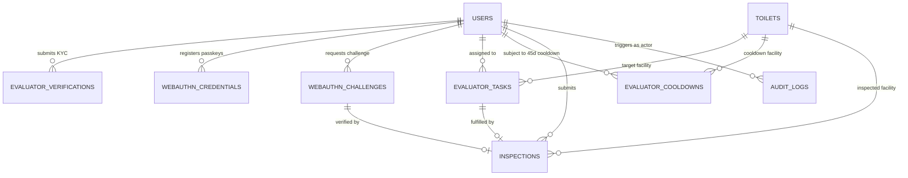

# PROPOSED — AWAITING SHUBHAM & SHABAZ'S APPROVAL — DO NOT EXECUTE WITHOUT REVIEW

**Document:** `docs/EVALUATOR_AUTH_DATABASE_PROPOSAL.md`  
**Stage:** Stage 2 — Evaluator Authentication Database & Schema Proposal  
**Target Owners:**
- **Shubham:** Database Schema, SQLAlchemy 2.0 ORM Models (`backend/app/db/base.py`), Alembic Migrations, and Inspection/Scoring Integration.
- **Shabaz:** Supabase Authentication, JWT Verification (`backend/app/core/security.py`), RBAC, and Row Level Security.
- **Ibrahim:** Evaluator Workflow Integration, Government Monitoring Coordination, and Cross-Module Orchestration.

> **Execution Boundary:** This document and its companion SQL file ([`docs/proposals/sql/20261031_evaluator_auth_schema.sql`](file:///d:/alliance-one-hackathon-2026/docs/proposals/sql/20261031_evaluator_auth_schema.sql)) are **unexecuted proposals**. Zero DDL or DML statements have been run against the shared Supabase database.

---

## 1. Design Principles & Existing Schema Preservation

1. **Single Canonical User Table (`public.users`):**
   - The shared Supabase database already contains `public.users`. We **do not** create a duplicate `public.profiles` table.
   - Instead, we extend `public.users` non-destructively with additive nullable/defaulted columns required for evaluator onboarding and administrative status tracking.
2. **Existing Evaluator Tables Preserved Intact:**
   - `public.evaluator_tasks` (`id`, `toilet_id`, `evaluator_id`, `status`, `photo_challenge_prompt`, `assigned_at`, `due_at`, `completed_at`) is preserved without modification.
   - `public.evaluator_cooldowns` (`id`, `evaluator_id`, `toilet_id`, `last_inspected_at`, `cooldown_until`) is preserved without modification.
   - `public.inspections` is preserved and extended only with an optional `submission_idempotency_key` (`varchar(128) UNIQUE`) and `webauthn_assertion_id` (`uuid`) to guarantee replay-free, idempotent inspection submissions.
3. **Separation of Sensitive Verification Metadata (`public.evaluator_verifications`):**
   - Government ID storage paths, reviewer notes, and rejection reasons are isolated in `public.evaluator_verifications` so routine queries against `public.users` never expose KYC storage paths or internal review notes.
4. **Multi-Device Cryptographic WebAuthn Storage (`public.webauthn_credentials` & `public.webauthn_challenges`):**
   - Stores public credential material, sign counters, transports, device labels, and revocation timestamps in `public.webauthn_credentials`, while short-lived, single-use, user- and operation-bound challenges live in `public.webauthn_challenges`.
5. **Append-Only Audit Trail (`public.audit_logs`):**
   - Captures every registration, ID upload, ID verification decision, passkey registration/revocation, account lifecycle transition, task acceptance, and inspection submission without storing secrets, tokens, biometric templates, or raw ID contents.

---

## 2. Legacy `public.users` WebAuthn & ID Columns Investigation

### 2.1 Existing Columns Inspected in `public.users`
From the Stage 1 live schema introspection of `public.users`:

| Column Name | Existing PostgreSQL Type | Nullable | Current Purpose |
| :--- | :--- | :---: | :--- |
| `id` | `uuid` (PK) | `NO` | Canonical user/evaluator ID (matches `auth.users.id`) |
| `full_name` | `character varying` | `NO` | Evaluator/citizen display name |
| `email` | `character varying` | `NO` | Verified email address |
| `phone` | `character varying` | `YES` | Phone number (reused instead of creating a duplicate `phone_number` column) |
| `role` | `character varying` | `NO` | Role (`citizen`, `evaluator`, `government`, `admin`) |
| `evaluator_status` | `character varying` | `YES` | Lifecycle status (`pending`, `approved`, `rejected`, `suspended`) |
| `id_document_url` | `text` | `YES` | Legacy inline document reference column |
| `webauthn_credential_id` | `text` | `YES` | Legacy single-device credential ID (`text`, base64url string) |
| `webauthn_public_key` | `text` | `YES` | Legacy single-device COSE public key (`text`, base64url string) |
| `wallet_balance` | `numeric` | `NO` | Evaluator wallet balance |
| `created_at` | `timestamp with time zone` | `NO` | Creation timestamp |
| `updated_at` | `timestamp with time zone` | `NO` | Last update timestamp |

### 2.2 Relationship & Non-Destructive Migration Strategy for Legacy WebAuthn Columns
1. **Why `users.webauthn_credential_id` and `users.webauthn_public_key` Are Insufficient Alone:**
   - They are scalar `text` columns on `public.users`, limiting an evaluator to a single device.
   - They lack `sign_count` (required by WebAuthn to detect cloned authenticators), `transports` (`internal`, `hybrid`, `usb`, `nfc`, `ble`), `device_name`, `last_used_at`, and `revoked_at`.
2. **Safe Backward-Compatible Migration & Counter Initialization Strategy:**
   - **Never drop or overwrite** `users.webauthn_credential_id`, `users.webauthn_public_key`, or `users.id_document_url`.
   - **Do NOT blindly assume `sign_count = 0` is valid for migrated legacy credentials:**
     - If a legacy authenticator has already incremented its internal hardware signature counter (`> 0`) prior to migration, or if its stored `webauthn_public_key` string is not a complete COSE key structure, blindly initializing `sign_count = 0` skips counter baseline calibration.
     - Therefore, `public.webauthn_credentials` includes a boolean column `sign_count_initialized` (`BOOLEAN NOT NULL DEFAULT true`) and `migration_source` (`VARCHAR(32) NOT NULL DEFAULT 'native' CHECK (migration_source IN ('native', 'legacy_users_table'))`).
     - Any row migrated from `public.users` is inserted with `sign_count = 0`, `sign_count_initialized = false`, and `migration_source = 'legacy_users_table'`.
     - **First-Use Counter Calibration or Re-Registration Requirement:**
       1. When a migrated credential (`migration_source = 'legacy_users_table'`) is used for the first time, the verifier first validates that `public_key` is a valid, parseable COSE key (ES256 `-7` or RS256 `-257`). If the legacy `webauthn_public_key` is not a valid COSE key (e.g., if an earlier prototype stored a placeholder or raw string), the backend rejects the assertion with `HTTP 409 Conflict` (`code="webauthn_legacy_re_registration_required"`) and prompts the authenticated evaluator to register a fresh passkey via `POST /api/v1/evaluators/passkeys/register/options`.
       2. If the legacy `public_key` is a valid COSE key and passes full cryptographic signature, challenge, origin, `rpIdHash`, `UP=1`, and `UV=1` verification, the first verified assertion calibrates the baseline counter (`SET sign_count = assertion.sign_count, sign_count_initialized = true, last_used_at = now()`) and logs `evaluator.legacy_passkey_calibrated` in `public.audit_logs`. All subsequent assertions strictly enforce `assertion.sign_count > stored.sign_count` (when `sign_count > 0`).
   - **Enforcing Uniqueness & Ownership:**
     - `credential_id` has a `UNIQUE` constraint on `public.webauthn_credentials (credential_id)`, ensuring a credential ID can never be registered to two different accounts.
     - Every authentication and revocation query filters by **both** `credential_id = :cred_id` **and** `user_id = :authenticated_user_id`.
   - **Allowing Existing Users to Re-Register Credentials:**
     - Because `public.webauthn_credentials` is a one-to-many table (`user_id -> many credentials`), an evaluator with a legacy or lost device can register a new passkey at any time after email/JWT authentication and revoke the old credential (`DELETE /api/v1/evaluators/passkeys/{credential_id}`), without requiring admin re-verification of their identity document if their `evaluator_status` is already `approved`.

---

## 3. Proposed Schema Extensions & New Tables

### 3.1 Additive Extensions to `public.users`
No existing columns are renamed or dropped. The following nullable/defaulted columns are added via `ALTER TABLE public.users ADD COLUMN IF NOT EXISTS`:

| Column Name | Type | Nullable | Default | Purpose |
| :--- | :--- | :---: | :--- | :--- |
| `operating_area` | `VARCHAR(150)` | `YES` | `NULL` | Evaluator's city, zone, or municipal ward operating area |
| `preferred_language` | `VARCHAR(32)` | `YES` | `'en'` | Preferred UI/notification language (`en`, `kn`, `hi`, etc.) |
| `application_reference` | `VARCHAR(64)` | `YES` (Unique) | `NULL` | Human-readable application tracking reference (e.g. `EV-2026-8F3A1C`) |
| `email_verified_at` | `TIMESTAMPTZ` | `YES` | `NULL` | Timestamp when Supabase Auth email verification was confirmed |
| `status_updated_by` | `UUID` (FK → `users.id`) | `YES` | `NULL` | Admin user ID who last changed `evaluator_status` |
| `status_updated_at` | `TIMESTAMPTZ` | `YES` | `NULL` | Timestamp of the last `evaluator_status` transition |
| `status_reason` | `TEXT` | `YES` | `NULL` | Reason recorded for approval, rejection, suspension, or reinstatement |

**Check Constraints (Non-Destructive):**
- `chk_users_role`: `role IN ('citizen', 'evaluator', 'government', 'admin')`
- `chk_users_evaluator_status`: `evaluator_status IS NULL OR evaluator_status IN ('pending', 'approved', 'rejected', 'suspended')`

---

### 3.2 `public.evaluator_verifications` (New Table)
Stores government identity document references and verification workflow state separately from `public.users`:

| Column Name | Type | Nullable | Constraints / Notes |
| :--- | :--- | :---: | :--- |
| `id` | `UUID` | `NO` | `PRIMARY KEY DEFAULT gen_random_uuid()` |
| `evaluator_id` | `UUID` | `NO` | `REFERENCES public.users(id) ON DELETE CASCADE` |
| `application_reference` | `VARCHAR(64)` | `NO` | Matches `users.application_reference` |
| `document_type` | `VARCHAR(64)` | `NO` | Allowed enum: `'aadhaar_redacted'`, `'voter_id'`, `'driving_licence'`, `'passport'`, `'pan_card'`, `'legacy_migrated'` |
| `document_storage_bucket` | `VARCHAR(64)` | `NO` | `DEFAULT 'evaluator-ids'` (must be private bucket) |
| `document_storage_path` | `TEXT` | `NO` | Object key inside private bucket: `evaluator-ids/{evaluator_id}/{verification_id}.{ext}` |
| `mime_type` | `VARCHAR(64)` | `NO` | Allowed: `'image/jpeg'`, `'image/png'`, `'image/webp'`, `'application/pdf'` |
| `file_size_bytes` | `INTEGER` | `NO` | `CHECK (file_size_bytes > 0 AND file_size_bytes <= 5242880)` (max 5 MB) |
| `sha256_checksum` | `CHAR(64)` | `NO` | Integrity digest of uploaded file (never logs or stores ID number) |
| `verification_status` | `VARCHAR(32)` | `NO` | `CHECK (verification_status IN ('pending', 'approved', 'rejected', 'expired_purged'))` |
| `reviewed_by` | `UUID` | `YES` | `REFERENCES public.users(id) ON DELETE SET NULL` (Admin reviewer) |
| `reviewed_at` | `TIMESTAMPTZ` | `YES` | Timestamp of admin verification decision |
| `rejection_reason` | `TEXT` | `YES` | Sanitized reason shown to evaluator if rejected |
| `retention_expires_at` | `TIMESTAMPTZ` | `YES` | Scheduled purge timestamp for raw storage object (7 days post-decision per [`PRIVACY_AND_THREAT_MODEL.md`](file:///d:/alliance-one-hackathon-2026/docs/PRIVACY_AND_THREAT_MODEL.md)) |
| `purged_at` | `TIMESTAMPTZ` | `YES` | Set when raw file is deleted from `evaluator-ids` bucket |
| `created_at` | `TIMESTAMPTZ` | `NO` | `DEFAULT now()` |
| `updated_at` | `TIMESTAMPTZ` | `NO` | `DEFAULT now()` |

**Indexes:**
- `idx_evaluator_verifications_evaluator_id` on `(evaluator_id, created_at DESC)`
- `idx_evaluator_verifications_status` on `(verification_status, created_at ASC)`

---

### 3.3 `public.webauthn_credentials` (New Table)
Stores only public cryptographic FIDO2/WebAuthn credential material. Supports multiple passkeys per evaluator and explicit credential revocation:

| Column Name | Type | Nullable | Constraints / Notes |
| :--- | :--- | :---: | :--- |
| `id` | `UUID` | `NO` | `PRIMARY KEY DEFAULT gen_random_uuid()` |
| `user_id` | `UUID` | `NO` | `REFERENCES public.users(id) ON DELETE CASCADE` |
| `credential_id` | `TEXT` | `NO` | `UNIQUE` — base64url-encoded WebAuthn credential ID |
| `public_key` | `TEXT` | `NO` | base64url-encoded COSE public key bytes |
| `sign_count` | `BIGINT` | `NO` | `DEFAULT 0 CHECK (sign_count >= 0)` — monotonic signature counter |
| `aaguid` | `VARCHAR(64)` | `YES` | Authenticator Attestation GUID |
| `transports` | `TEXT[]` | `NO` | `DEFAULT '{}'::text[]` (e.g. `{'internal','hybrid'}`) |
| `device_name` | `VARCHAR(120)` | `NO` | User-friendly authenticator label (e.g. `'Android Fingerprint / Passkey'`) |
| `backed_up` | `BOOLEAN` | `NO` | `DEFAULT false` (WebAuthn `BE`/`BS` flags) |
| `user_verified_on_register` | `BOOLEAN` | `NO` | `DEFAULT true` (`UV` flag confirmed at registration) |
| `created_at` | `TIMESTAMPTZ` | `NO` | `DEFAULT now()` |
| `last_used_at` | `TIMESTAMPTZ` | `YES` | Updated on every verified assertion |
| `revoked_at` | `TIMESTAMPTZ` | `YES` | Non-null when revoked by evaluator or admin |
| `revoked_by` | `UUID` | `YES` | `REFERENCES public.users(id) ON DELETE SET NULL` |
| `revoke_reason` | `TEXT` | `YES` | Reason for revocation |

**Indexes:**
- `idx_webauthn_credentials_user_active` on `(user_id) WHERE revoked_at IS NULL`
- `idx_webauthn_credentials_credential_id` unique on `(credential_id)`

---

### 3.4 `public.webauthn_challenges` (New Table)
Stores short-lived, single-use cryptographic challenges bound to a specific `user_id` and `purpose` (`registration`, `authentication`, `inspection_submit`):

| Column Name | Type | Nullable | Constraints / Notes |
| :--- | :--- | :---: | :--- |
| `id` | `UUID` | `NO` | `PRIMARY KEY DEFAULT gen_random_uuid()` |
| `user_id` | `UUID` | `NO` | `REFERENCES public.users(id) ON DELETE CASCADE` |
| `challenge` | `VARCHAR(128)` | `NO` | `UNIQUE` — 32+ bytes CSPRNG base64url-encoded challenge |
| `purpose` | `VARCHAR(32)` | `NO` | `CHECK (purpose IN ('registration', 'authentication', 'inspection_submit'))` |
| `operation_context` | `JSONB` | `NO` | `DEFAULT '{}'::jsonb` — binds `task_id` / `toilet_id` when `purpose = 'inspection_submit'` |
| `rp_id` | `VARCHAR(255)` | `NO` | Expected Relying Party ID (e.g. `localhost` or production domain) |
| `expected_origin` | `VARCHAR(255)` | `NO` | Expected WebAuthn origin (`https://...` or `http://localhost:5173`) |
| `user_verification` | `VARCHAR(16)` | `NO` | `DEFAULT 'required' CHECK (user_verification IN ('required', 'preferred'))` |
| `expires_at` | `TIMESTAMPTZ` | `NO` | Short TTL (`now() + interval '5 minutes'`) |
| `consumed_at` | `TIMESTAMPTZ` | `YES` | Set atomically (`UPDATE ... WHERE consumed_at IS NULL`) on verification |
| `created_at` | `TIMESTAMPTZ` | `NO` | `DEFAULT now()` |

**Indexes:**
- `idx_webauthn_challenges_user_purpose` on `(user_id, purpose, expires_at DESC)`
- `idx_webauthn_challenges_challenge` unique on `(challenge)`

---

### 3.5 `public.audit_logs` (New Table — Append-Only)
Immutable audit log for all security-critical evaluator and administrative events:

| Column Name | Type | Nullable | Constraints / Notes |
| :--- | :--- | :---: | :--- |
| `id` | `UUID` | `NO` | `PRIMARY KEY DEFAULT gen_random_uuid()` |
| `actor_id` | `UUID` | `YES` | `REFERENCES public.users(id) ON DELETE SET NULL` |
| `actor_role` | `VARCHAR(32)` | `NO` | Role at time of action (`evaluator`, `admin`, `government`, `system`) |
| `action` | `VARCHAR(64)` | `NO` | Standardized action code (see Section 5 below) |
| `target_type` | `VARCHAR(64)` | `NO` | `'evaluator_account'`, `'identity_document'`, `'webauthn_passkey'`, `'evaluator_task'`, `'inspection'` |
| `target_id` | `VARCHAR(128)` | `NO` | UUID or identifier of the target entity |
| `previous_status` | `VARCHAR(32)` | `YES` | Recorded for account/verification lifecycle transitions |
| `new_status` | `VARCHAR(32)` | `YES` | Recorded for account/verification lifecycle transitions |
| `reason` | `TEXT` | `YES` | Explicit human-readable justification (mandatory for reject/suspend/reinstate) |
| `metadata` | `JSONB` | `NO` | `DEFAULT '{}'::jsonb` — sanitized context (`application_reference`, `task_id`, `credential_device_name`; **never** tokens, passwords, biometrics, or ID numbers) |
| `created_at` | `TIMESTAMPTZ` | `NO` | `DEFAULT now()` |

**Immutability Protection:**
- Database trigger `trg_audit_logs_immutable` raises an exception on any `UPDATE` or `DELETE` against `public.audit_logs`, enforcing append-only behavior even for privileged connections.

---

### 3.6 Additive Idempotency & Assertion Columns on `public.inspections`
To connect Stage 4/7 WebAuthn assertion verification to existing `public.inspections` without breaking Shubham's columns:
- `submission_idempotency_key VARCHAR(128) UNIQUE` (prevents duplicate inspection submissions on network retry).
- `webauthn_credential_id_used TEXT` (records which registered passkey signed the inspection submission).
- `webauthn_challenge_id UUID REFERENCES public.webauthn_challenges(id)` (links the consumed single-use `inspection_submit` challenge).

---

## 4. Entity-Relationship Diagram

---

## 5. Standardized Audit Action Codes

| Action Code | Triggering Event | Target Type | Required Metadata |
| :--- | :--- | :--- | :--- |
| `evaluator.registered` | Evaluator submits onboarding profile | `evaluator_account` | `application_reference`, `operating_area` |
| `evaluator.document_uploaded` | Government ID uploaded to `evaluator-ids` | `identity_document` | `verification_id`, `document_type`, `mime_type`, `file_size_bytes` |
| `evaluator.document_previewed` | Admin generates 60s signed preview URL | `identity_document` | `verification_id`, `expires_in_seconds` |
| `evaluator.passkey_registered` | WebAuthn attestation verified & stored | `webauthn_passkey` | `credential_row_id`, `device_name`, `transports` |
| `evaluator.passkey_revoked` | Evaluator or admin revokes a passkey | `webauthn_passkey` | `credential_row_id`, `device_name`, `revoke_reason` |
| `evaluator.approved` | Admin approves pending evaluator (`pending -> approved`) | `evaluator_account` | `application_reference`, `verification_id` |
| `evaluator.rejected` | Admin rejects pending evaluator (`pending -> rejected`) | `evaluator_account` | `application_reference`, `reason` |
| `evaluator.resubmitted` | Rejected evaluator resubmits (`rejected -> pending`) | `evaluator_account` | `application_reference`, `new_verification_id` |
| `evaluator.suspended` | Admin suspends approved evaluator (`approved -> suspended`) | `evaluator_account` | `application_reference`, `reason` |
| `evaluator.reinstated` | Admin reinstates suspended evaluator (`suspended -> approved`) | `evaluator_account` | `application_reference`, `reason` |
| `evaluator.task_accepted` | Approved evaluator accepts assigned task | `evaluator_task` | `task_id`, `toilet_id` |
| `evaluator.inspection_submitted` | WebAuthn assertion verified & inspection saved | `inspection` | `inspection_id`, `task_id`, `toilet_id`, `challenge_id`, `idempotency_key` |
| `security.privileged_access_denied` | Unauthorized role or invalid status attempts protected operation | `evaluator_account` | `endpoint`, `required_role_or_status`, `actual_role_or_status` |

