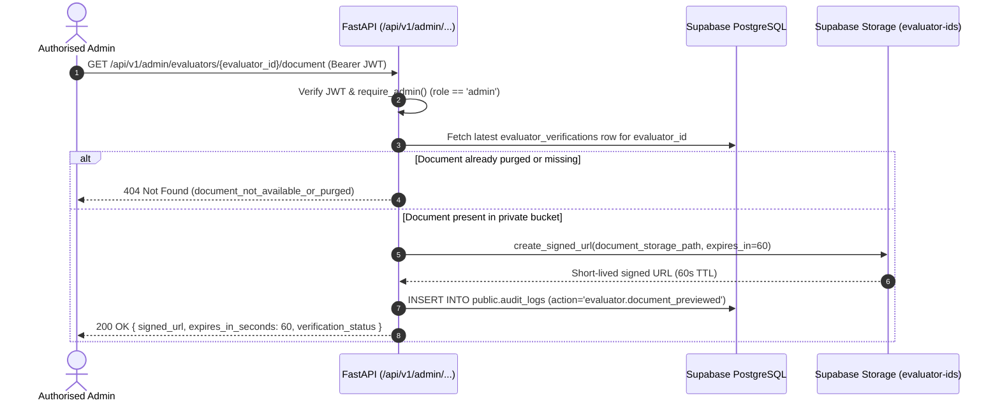

# PROPOSED — AWAITING SHABAZ & SHUBHAM'S APPROVAL — DO NOT EXECUTE WITHOUT REVIEW

**Document:** `docs/EVALUATOR_ID_STORAGE_SECURITY.md`  
**Stage:** Stage 2 — Private Government ID & Inspection Evidence Storage Security Architecture  
**Owners:** **Shabaz** (Storage Policies & Access Security) / **Ibrahim** (Evaluator Upload & Admin Review Service) / **Shubham** (Verification Schema)

---

## 1. Security Objectives

Government identity documents uploaded by gig-worker evaluators during onboarding are high-sensitivity personal data under the **Digital Personal Data Protection Act, 2023 (DPDP Act, India)**. Our storage architecture enforces:

1. **Private-Only Bucket (`evaluator-ids`):** `public = false` at the Supabase Storage bucket level. No permanent or unauthenticated public URLs can ever be generated for objects in `evaluator-ids`.
2. **Backend-Mediated Upload & Validation:** Files are validated by FastAPI for MIME type, magic-byte file signature, size (`<= 5 MB`), and non-executable content before storage.
3. **Zero Cross-Evaluator Access (IDOR Prevention):** Object keys are strictly partitioned by the server-verified `user_id` (`evaluator-ids/{evaluator_id}/{verification_id}.{ext}`), and direct client `SELECT` on `storage.objects` is disabled.
4. **Short-Lived Signed Preview URLs for Admins Only:** Only an authenticated `admin` calling `GET /api/v1/admin/evaluators/{evaluator_id}/document` can generate a short-lived signed URL (`expires_in = 60 seconds`), and every preview generation is recorded in `public.audit_logs` (`action = 'evaluator.document_previewed'`).
5. **Data Minimisation & Automated Retention Purge:** Raw identity document files are retained only until verification is completed plus a 7-day dispute/audit window (`retention_expires_at = reviewed_at + interval '7 days'`), after which the storage object is permanently deleted while retaining only the boolean/status verification metadata in `public.evaluator_verifications`.

---

## 2. Bucket Configuration Specification

### 2.1 Bucket 1: `evaluator-ids` (Government Identity Documents)
| Setting | Value | Rationale |
| :--- | :--- | :--- |
| **`id` / `name`** | `evaluator-ids` | Dedicated isolated bucket for KYC identity documents |
| **`public`** | `false` (**STRICTLY PRIVATE**) | Prevents `/storage/v1/object/public/evaluator-ids/...` access |
| **`file_size_limit`** | `5242880` (`5 MB`) | Prevents storage exhaustion / DoS uploads |
| **`allowed_mime_types`** | `['image/jpeg', 'image/png', 'image/webp', 'application/pdf']` | Rejects HTML, SVG (XSS vector), scripts, archives, and executables |

### 2.2 Bucket 2: `inspection-evidence` (Evaluator Inspection Photographs)
| Setting | Value | Rationale |
| :--- | :--- | :--- |
| **`id` / `name`** | `inspection-evidence` | Dedicated private bucket for on-site washroom inspection photos |
| **`public`** | `false` (**PRIVATE BY DEFAULT**) | Unreviewed photos may inadvertently capture bystanders or reflections; served via signed URLs until reviewed |
| **`file_size_limit`** | `10485760` (`10 MB`) | Accommodates high-resolution mobile camera captures |
| **`allowed_mime_types`** | `['image/jpeg', 'image/png', 'image/webp']` | Standard camera image formats only |

---

## 3. Object Key Naming & Path Isolation Convention

```text
evaluator-ids/{evaluator_uuid}/{verification_uuid}.{ext}
```

- **`{evaluator_uuid}`**: Always taken from the server-verified JWT `sub` (`auth.uid()`), **never** from a client-supplied form field or filename.
- **`{verification_uuid}`**: Newly generated UUIDv4 per submission (`public.evaluator_verifications.id`).
- **`{ext}`**: Canonical extension derived from the verified magic bytes (`jpg`, `png`, `webp`, or `pdf`)—the original user-supplied filename is **never** used in the storage key, eliminating path traversal (`../`), null-byte injection, and PII leakage in filenames.

---

## 4. Multi-Layer Upload Validation Pipeline (`POST /api/v1/evaluators/documents`)

When an authenticated evaluator uploads an identity document:

1. **Authentication & Lifecycle Guard:**
   - Caller must pass `require_evaluator`.
   - Evaluator's `evaluator_status` must be `pending` (or `rejected` during an authorised resubmission). An already `approved` or `suspended` evaluator is rejected with `HTTP 409 Conflict` (`code="document_upload_not_permitted"`).
2. **Document Type Allow-List:**
   - Accepts only `document_type` in `{'aadhaar_redacted', 'voter_id', 'driving_licence', 'passport', 'pan_card'}`.
   - If `aadhaar_redacted` is selected, the UI and API instruct the evaluator to upload a masked Aadhaar showing only the last 4 digits.
3. **File Size Validation:**
   - Rejects empty (`0` bytes) or oversized (`> 5,242,880` bytes) payloads with `HTTP 413` / `HTTP 422`.
4. **Magic-Byte (File Signature) Inspection:**
   - Does **not** trust the HTTP `Content-Type` header or filename extension alone.
   - Verifies the leading bytes of the file buffer:
     - `JPEG`: starts with `\xFF\xD8\xFF`
     - `PNG`: starts with `\x89PNG\r\n\x1a\n`
     - `WEBP`: starts with `RIFF` and bytes `8..12 == b"WEBP"`
     - `PDF`: starts with `%PDF-` (and scans to reject embedded `/JavaScript` or `/JS` actions)
   - Explicitly rejects `MZ` (Windows PE `.exe`), `\x7fELF` (Linux binary), `#!` (shell scripts), `PK\x03\x04` (ZIP/APK/JAR), and `<svg` / `<html` / `<script` payloads.
5. **SHA-256 Checksum & Zero Content Logging:**
   - Computes `sha256_checksum = hashlib.sha256(file_bytes).hexdigest()`.
   - Stores the object in `evaluator-ids/{evaluator_id}/{verification_id}.{ext}` via the backend-only Supabase Storage client.
   - Inserts a metadata row in `public.evaluator_verifications` (`verification_status = 'pending'`).
   - Appends an `evaluator.document_uploaded` record to `public.audit_logs` containing only `verification_id`, `document_type`, `mime_type`, and `file_size_bytes` (**never** logging image bytes, OCR text, or ID numbers).

---

## 5. Authorised Admin Preview Workflow (`GET /api/v1/admin/evaluators/{evaluator_id}/document`)



- **Why Evaluators Cannot Preview Raw ID Files After Upload:**
  - `GET /api/v1/evaluators/documents/status` returns only `{ verification_id, document_type, verification_status, uploaded_at, reviewed_at, rejection_reason }`—never the storage path or signed URL. If an evaluator's session is ever compromised on a shared phone, the attacker cannot download the previously uploaded government ID.

---

## 6. Storage RLS Policy Design (`storage.objects`)

Included in [`docs/proposals/sql/20261031_evaluator_auth_rls.sql`](file:///d:/alliance-one-hackathon-2026/docs/proposals/sql/20261031_evaluator_auth_rls.sql):

1. **Deny All Direct `anon` Access:** Anonymous users have zero `SELECT`, `INSERT`, `UPDATE`, or `DELETE` access to `storage.objects` in `evaluator-ids` or `inspection-evidence`.
2. **Deny All Direct `authenticated` Access to `evaluator-ids`:**
   - Because all uploads (`POST /api/v1/evaluators/documents`) and admin signed-URL previews (`GET /api/v1/admin/evaluators/{id}/document`) are executed by the FastAPI backend using server-side credentials after strict validation and audit logging, **no direct client `storage.objects` policies are granted on `evaluator-ids`**.
   - Even if an evaluator or citizen crafts a direct Supabase Storage API call with their JWT, Storage RLS denies `SELECT`, `INSERT`, `UPDATE`, and `DELETE` on `bucket_id = 'evaluator-ids'`.

---

## 7. Government ID Retention, Appeal Window & Verifiable Deletion Policy

### 7.1 Operational Justification for Post-Decision Retention
- **Why Raw ID Files Are Not Kept Indefinitely:** Under Section 8(7) of the **Digital Personal Data Protection Act, 2023 (DPDP Act, India)**, a Data Fiduciary must erase personal data as soon as the specified purpose (`identity verification for evaluator onboarding`) is no longer served, unless retention is required for compliance with law. Once an administrator has verified the document (`approved`) or the rejection/appeal window has closed (`rejected`), retaining the raw image/PDF of a citizen's government ID increases breach liability without adding operational value.
- **Why Raw ID Files Are Not Deleted at the Exact Millisecond of Decision:**
  1. **Approved Applications (7-Day Post-Approval Quality/Audit Window):** Retaining the object for **7 days** after `reviewed_at` (`retention_expires_at = reviewed_at + INTERVAL '7 days'`) allows a senior administrator to audit the approving administrator's decision against collusion or mistaken approval before the raw file is permanently purged.
  2. **Rejected Applications (7-Day Appeal / Resubmission Window):** If an application is rejected (e.g. blurry scan or mismatched name), the 7-day window allows the evaluator to request a supervisory review of the same submission or upload a corrected document (`rejected -> pending` resubmission, which immediately schedules the superseded file for deletion).
- **Legal Review Requirement:** Before production launch, legal counsel must confirm whether any municipal contractor bookkeeping, tax/payout audit (for gig-worker rewards in `wallet_balance`), or labour regulation requires retaining KYC proof longer than 7 days, or whether retaining the cryptographic `sha256_checksum`, `document_type`, `reviewed_by`, and `reviewed_at` metadata satisfies audit requirements. **The system never silently extends retention.**

### 7.2 What Happens After Rejection, Appeal, or Resubmission
1. **Rejection (`pending -> rejected`):**
   - Admin records `rejection_reason` and sets `verification_status = 'rejected'`, `reviewed_at = now()`, and `retention_expires_at = now() + INTERVAL '7 days'`.
   - If the evaluator submits a new document (`rejected -> pending`), a new `evaluator_verifications` row is created and the previous rejected storage object is queued for immediate deletion (`retention_expires_at = now()`).
2. **Expiry of 7-Day Window (`now() >= retention_expires_at`):**
   - The backend purge service deletes the object from the `evaluator-ids` bucket via the Supabase Storage Admin API.
   - **Deletion Verification Step:** Before marking the database row as purged, the purge service issues a verification check (`head`/`info` or list check on `document_storage_path` in `evaluator-ids`) confirming the storage object returns `404 Not Found`.
   - Only after storage deletion is verified does the backend update `public.evaluator_verifications`:
     - `purged_at = now()`
     - `deletion_verified = true`
     - `document_storage_path = 'PURGED'`
     - `users.id_document_url = NULL`
   - An immutable audit record (`action = 'evaluator.document_purged'`) is written to `public.audit_logs`.

### 7.3 Metadata Retained After Raw Document Deletion
After the raw image/PDF is deleted from `evaluator-ids`, **only** the following non-PII verification metadata remains in `public.evaluator_verifications`:
- `id` (verification UUID)
- `evaluator_id` (UUID)
- `application_reference` (e.g. `EV-2026-8F3A1C`)
- `document_type` (e.g. `driving_licence`, `voter_id` — **never** the document number)
- `sha256_checksum` (one-way hash of the original file bytes)
- `verification_status` (`approved` or `expired_purged`)
- `reviewed_by` (approving/rejecting admin UUID)
- `reviewed_at`, `purged_at`, and `deletion_verified = true`

