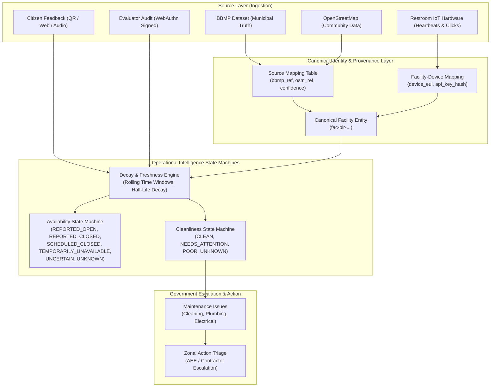
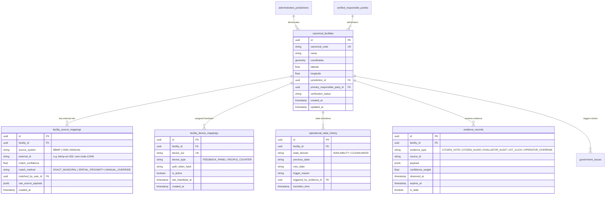
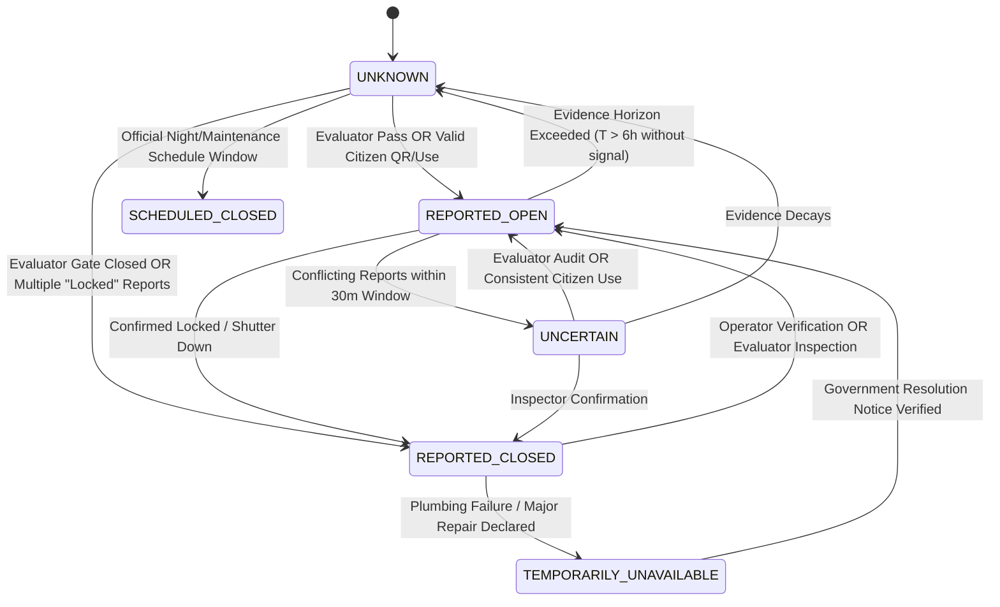
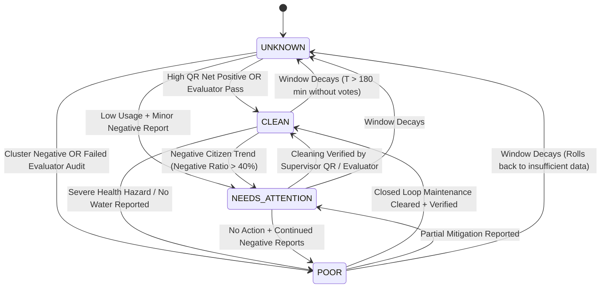
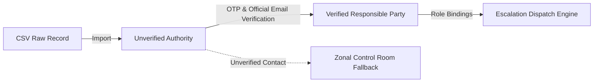

# Stage 3 Design: Canonical Facility Identity & Operational Intelligence

**Document Status:** PROPOSAL / ARCHITECTURAL DESIGN  
**Author / Lead:** Antigravity AI Pair Programmer  
**Collaborators & Module Owners:**  
- **Shubham:** Database Schema, ORM Models, Migrations, Scoring & Intelligence  
- **Shabaz:** Authentication, JWT Verification, RBAC, RLS & Storage Security  
- **Ibrahim:** Government Backend, Evaluator Workflow, Discovery & Cross-Module Orchestration  

---

## 1. Architectural Overview & Context

Namma Suvidha ingests data from disparate sources with varying levels of trust, frequency, and granularity:
- **BBMP Municipal Open Data:** Authoritative for administrative jurisdictions (Ward, Zone, Division), engineer attribution (AEE, AE), and historical infrastructure.
- **OpenStreetMap (OSM):** Community-driven geographic points of interest, accessibility tags, and non-municipal public toilets (e.g. metro stations, shopping complexes).
- **Citizen Telemetry:** High-frequency, unauthenticated/pseudonymous YES/NO QR cleanliness ratings, category complaints, and multilingual voice explanations.
- **Evaluator Inspections:** Cryptographically signed WebAuthn audit reports with structured checklists, photos, and high trust.
- **Physical IoT Devices:** Ambient restroom feedback buttons (3-button smiley panels) and sensor heartbeats.
- **Government Monitoring:** Maintenance tickets, escalation trees, and dispatch tracking.

To avoid data pollution, premature record merging, and loss of provenance, Namma Suvidha separates **Canonical Identity**, **Static Infrastructure Provenance**, and **Dynamic Operational Intelligence**.



---

## 2. Canonical Facility Identity Model

### 2.1 Persistence Strategy & UUID Namespace
- **Format:** `fac-blr-<nanoid_or_uuidv7>` (e.g. `fac-blr-01932f4e-89a1-7910-82a1-63cb5d4e112a`).
- Every canonical facility possesses one immutable system ID.
- **Multi-Complex Support (Identical Coordinates):**
  - Bus stands and market complexes often house distinct facilities (Gents block vs Ladies block, East wing vs West wing) sharing the identical GPS point.
  - Rather than conflating coordinates, each complex maintains its own canonical facility record, linked via `parent_complex_id` or sub-location identifiers.
- **Non-Destructive Reconciliation:**
  - Source records from BBMP or OSM are **never** destructively overwritten or combined.
  - Matches are recorded in an auditable association table (`facility_source_mappings`) with confidence scores and verification audit trails.

### 2.2 Entity Relationship Diagram (ERD Proposal)



---

## 3. Facility Operational State Machines

Availability and Cleanliness are decoupled into orthogonal, deterministic state machines.

### 3.1 Availability State Machine



#### Valid States:
1. `REPORTED_OPEN`: Active citizen use, evaluator verified open, or verified operator check-in within freshness window.
2. `REPORTED_CLOSED`: Reported locked/closed by inspector or validated negative citizen cluster.
3. `SCHEDULED_CLOSED`: Determined by municipal curfew/timings (e.g. 23:00–05:00 for neighborhood parks).
4. `TEMPORARILY_UNAVAILABLE`: Active maintenance, water cutoff, or drainage overhaul in progress.
5. `UNCERTAIN`: Conflicting telemetry (e.g. 2 votes say open, 2 say closed within same 30m window).
6. `UNKNOWN`: No fresh evidence received within the decay threshold ($T > 6\text{ hours}$).

### 3.2 Cleanliness State Machine



#### Valid States:
1. `CLEAN`: Net positive ratio $\ge 70\%$ in latest evaluation window with $\ge 3$ distinct votes, or passed evaluator audit.
2. `NEEDS_ATTENTION`: Negative ratio between $40\% - 70\%$, minor smell/dispenser complaints, or unverified single negative reports.
3. `POOR`: Negative ratio $> 70\%$ with minimum quorum, broken equipment/no water reports, or failed inspector audit.
4. `UNKNOWN`: Insufficient votes ($N < 3$) or evidence older than evaluation window ($T > 180\text{ min}$). **Never defaulted to CLEAN.**

---

## 4. Evidence Processing, Confidence Weights & Freshness Engine

### 4.1 Strict Source Separation & Weighting Hierarchy

| Evidence Stream | Weight ($\omega_i$) | Freshness Half-Life ($t_{1/2}$) | Validation Requirement |
|---|---|---|---|
| **Evaluator Inspection** | $1.00$ | $7\text{ days}$ | WebAuthn P-256 signature, GPS within 50m of facility. |
| **Operator Confirmation** | $0.85$ | $12\text{ hours}$ | Verified credential + supervisor OTP. |
| **Citizen QR Vote** | $0.40$ | $60\text{ minutes}$ | Unique browser fingerprint/session hash, rate-limited. |
| **Citizen App/Web Voice** | $0.50$ | $120\text{ minutes}$ | Audio transcription + category extraction. |
| **IoT Physical Button** | $0.35$ | $30\text{ minutes}$ | Cryptographic device token, debounce algorithm ($< 5\text{s}$). |
| **AI Advisory Output** | **0.00 (Advisory Only)** | $24\text{ hours}$ | Strict Pydantic parsing; **cannot independently mutate scores**. |
| **IoT Device Heartbeat** | **0.00 (Network Only)** | $15\text{ minutes}$ | Indicates hardware connectivity; **never proves facility is open**. |

### 4.2 Mathematical Decay & Aggregation
Given evidence items $e_1, e_2, \dots, e_k$ observed at times $t_i$:
$$\text{Age}_i = t_{\text{current}} - t_i$$
$$\text{DecayFactor}_i = \exp\left(-\frac{\ln(2) \cdot \text{Age}_i}{t_{1/2}}\right)$$
$$\text{EffectiveWeight}_i = \omega_i \cdot \text{DecayFactor}_i$$

When $\sum \text{EffectiveWeight}_i < \text{QuorumThreshold}$, the operational state automatically falls back to `UNKNOWN`.

---

## 5. Administrative Ownership, Verification & Escalation

### 5.1 Verification Boundary
The raw BBMP CSV contains names for AEEs, AEs, and contractors. **These are treated as unverified claims until administrative verification occurs.**



1. **Unverified Contact Safe Fallback:**
   - If a facility has an unverified contractor/engineer, complaints and alerts are dispatched to the **Central Zonal Sanitation Control Room**, never to personal unverified phone numbers or external emails.
2. **Authorised Ownership Roles:**
   - `ZONAL_CHIEF_ENGINEER`: Oversees entire zone (e.g. Mahadevapura, Yelahanka).
   - `EXECUTIVE_ENGINEER (EE)`: Division lead.
   - `ASSISTANT_EXECUTIVE_ENGINEER (AEE)`: Sub-division custodian.
   - `ASSISTANT_ENGINEER (AE)`: Ward field officer.
   - `PRIVATE_CONTACTOR_SUPERVISOR`: On-ground cleaning vendor.

---

## 6. Proposed Schema (DDL Proposal for Shubham's Review)

```sql
-- DDL PROPOSAL: DO NOT EXECUTE DIRECTLY
-- Module: Facilities & Operational Intelligence
-- Schema Owner: Shubham

CREATE TABLE IF NOT EXISTS public.canonical_facilities (
    id UUID PRIMARY KEY DEFAULT gen_random_uuid(),
    canonical_code VARCHAR(64) UNIQUE NOT NULL,
    name VARCHAR(255) NOT NULL,
    latitude DOUBLE PRECISION NOT NULL,
    longitude DOUBLE PRECISION NOT NULL,
    ward_no VARCHAR(32),
    ward_name VARCHAR(128),
    zone VARCHAR(64),
    division VARCHAR(64),
    sub_division VARCHAR(64),
    verification_status VARCHAR(32) NOT NULL DEFAULT 'unverified',
    primary_responsible_party_id UUID,
    created_at TIMESTAMPTZ NOT NULL DEFAULT timezone('utc', now()),
    updated_at TIMESTAMPTZ NOT NULL DEFAULT timezone('utc', now()),
    CONSTRAINT valid_lat CHECK (latitude BETWEEN -90.0 AND 90.0),
    CONSTRAINT valid_lon CHECK (longitude BETWEEN -180.0 AND 180.0)
);

CREATE TABLE IF NOT EXISTS public.facility_source_mappings (
    id UUID PRIMARY KEY DEFAULT gen_random_uuid(),
    facility_id UUID NOT NULL REFERENCES public.canonical_facilities(id) ON DELETE RESTRICT,
    source_system VARCHAR(32) NOT NULL, -- 'BBMP', 'OSM', 'COMMUNITY'
    external_id VARCHAR(128) NOT NULL,
    match_confidence DOUBLE PRECISION NOT NULL DEFAULT 1.0,
    match_method VARCHAR(64) NOT NULL, -- 'PRIMARY_IMPORT', 'SPATIAL_CLUSTER', 'MANUAL'
    raw_payload JSONB,
    created_at TIMESTAMPTZ NOT NULL DEFAULT timezone('utc', now()),
    CONSTRAINT uq_source_external UNIQUE (source_system, external_id)
);

CREATE TABLE IF NOT EXISTS public.facility_operational_states (
    facility_id UUID PRIMARY KEY REFERENCES public.canonical_facilities(id) ON DELETE CASCADE,
    availability_state VARCHAR(32) NOT NULL DEFAULT 'UNKNOWN',
    cleanliness_state VARCHAR(32) NOT NULL DEFAULT 'UNKNOWN',
    last_availability_transition TIMESTAMPTZ NOT NULL DEFAULT timezone('utc', now()),
    last_cleanliness_transition TIMESTAMPTZ NOT NULL DEFAULT timezone('utc', now()),
    confidence_score DOUBLE PRECISION NOT NULL DEFAULT 0.0,
    updated_at TIMESTAMPTZ NOT NULL DEFAULT timezone('utc', now())
);

CREATE INDEX IF NOT EXISTS idx_canonical_facilities_geo ON public.canonical_facilities(latitude, longitude);
CREATE INDEX IF NOT EXISTS idx_canonical_facilities_ward ON public.canonical_facilities(ward_name, zone);
```

---

## 7. Migration Dependencies & Ownership Approvals

1. **Database Schema Approval:**
   - **Shubham (Schema Owner):** Must approve `canonical_facilities`, `facility_source_mappings`, and `facility_operational_states` before any Alembic migration or SQL deployment.
2. **Security & RLS Approval:**
   - **Shabaz (Auth & Security Owner):** Must approve row-level security policies to ensure PII (AEE/AE personal numbers and emails) is never exposed via public citizen anon tokens.
3. **Government Workflow Integration:**
   - **Ibrahim (Workflow Owner):** Integrates the canonical facility IDs into the existing ticket dispatch and inspection pipelines.

---

## 8. Component Classification & Readiness Matrix

| Component | Status | Verification & Readiness Notes |
|---|---|---|
| **BBMP Data Parser & Cleaner** | **TESTED** | 479 valid records parsed; coordinate bounds verified. |
| **Canonical Entity Definition** | **PROPOSED** | Domain models designed; ORM schema prepared for Shubham. |
| **Availability State Machine** | **PROPOSED** | 6-state deterministic flow documented with decay rules. |
| **Cleanliness State Machine** | **PROPOSED** | 4-state decoupled flow; default `UNKNOWN` on missing data. |
| **Decoupled Freshness Engine** | **PROPOSED** | Exponential time decay & weighted quorum rules defined. |
| **Physical IoT Heartbeat Boundary** | **PROPOSED** | Architectural firewall preventing heartbeat $\to$ open conflation. |
| **Admin PII Redaction** | **IMPLEMENTED** | `redact_responsible_party()` in Government module protecting contact PII. |
| **Database DDL Execution** | **BLOCKED** | Blocked pending team review and explicit authorization. |

