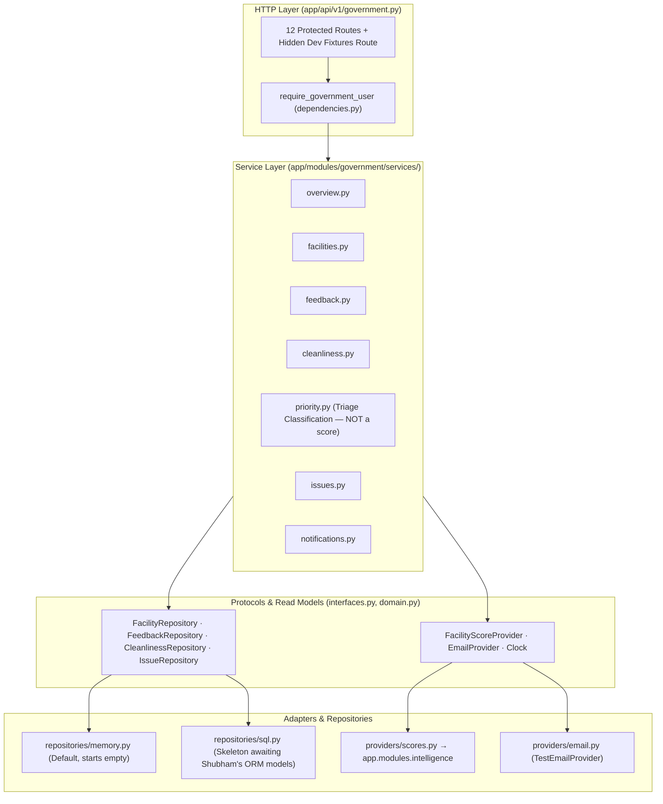
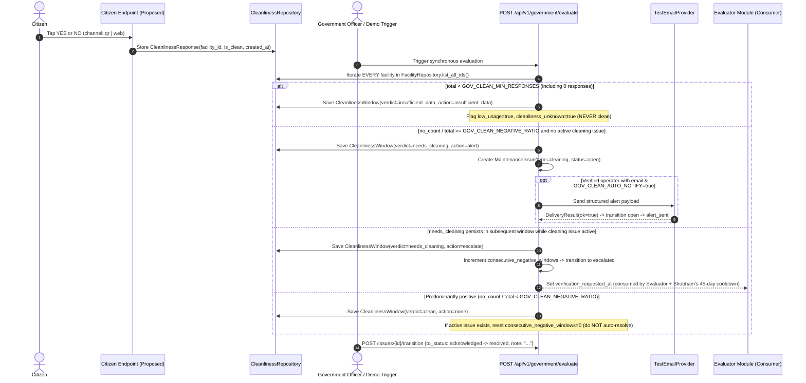
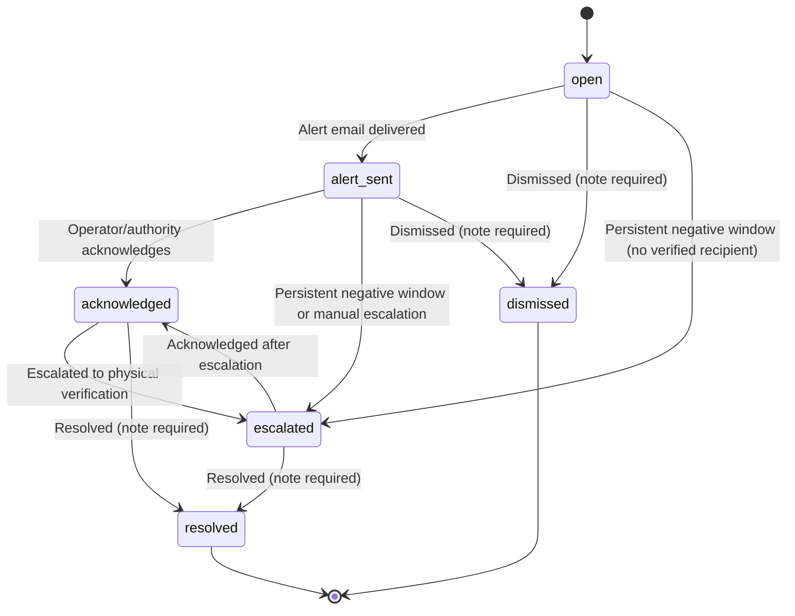

# Government Monitoring & Feedback-Driven Cleaning

**Module Owner:** Ibrahim  
**Backend Path:** `backend/app/modules/government/`  
**API Prefix:** `/api/v1/government`  
**Frontend Typed Client:** `frontend/src/lib/api/government.ts` & `government.types.ts`

---

## 1. Module Overview & Layer Diagram

The Government Monitoring backend gives sanitation authorities a single view of public toilet facilities, verified inspections, citizen feedback, **feedback-driven cleaning alerts**, and maintenance issues — while keeping citizen feedback strictly separate from evaluator inspections and consuming official facility scores from `app.modules.intelligence` without duplicating scoring or allocation logic.



---

## 2. Feedback-Driven Cleaning Workflow

Citizens can submit one-tap YES/NO cleanliness responses via QR code or web link at a facility (`POST /api/v1/citizen/facilities/{facility_id}/cleanliness` — proposed Citizen endpoint). Government aggregates those responses synchronously when `POST /api/v1/government/evaluate` is called.



---

## 3. Execution Model and Missed Windows

- **Synchronous, on-demand execution:** `POST /api/v1/government/evaluate` executes synchronously inside the HTTP request. No background worker, scheduler, cron job, Redis queue, or Celery task exists in Phase 2.
- **Latest complete window only (no backfill):** Given `now` and `GOV_CLEAN_WINDOW_MINUTES` (default `60`), `/evaluate` computes the single most recent **complete** aligned window `[window_start, window_end)` where `window_end <= now`. If `/evaluate` was not called during earlier windows, **earlier missed windows are not backfilled in this MVP**. The raw `CleanlinessResponse` records remain stored and countable (for example, in the 24-hour low-usage check), and `EvaluationSummary.note` explicitly states:
  > `"Processed latest complete window only; earlier missed windows are not backfilled in this MVP."`
- **Idempotency:** If a `CleanlinessWindow` already exists for `(facility_id, window_start)`, that facility is skipped (`skipped_existing` increments) and no duplicate issues or emails are created.
- **Periodic caller out of scope:** Calling `/evaluate` on a schedule (via an external cron or demo script) is a separate operational decision and is not embedded in the backend in Phase 2.

---

## 4. The Low-Usage Rule (Silence Is Never Cleanliness)

**Evaluated over all facilities: zero responses $\Rightarrow$ low usage $\Rightarrow$ cleanliness unknown.**

1. During both `POST /evaluate` and every facility/overview query, the low-usage guard checks `count_responses(facility_id, now - GOV_CLEAN_LOW_USAGE_HOURS, now)` across **every** facility in `FacilityRepository.list_all_ids()` — not only facilities that received responses.
2. Any facility with fewer than `GOV_CLEAN_MIN_RESPONSES` (default `3`, **including `0` responses**) in the last `GOV_CLEAN_LOW_USAGE_HOURS` (default `24` hours) is flagged with:
   - `data_quality.low_usage = true`
   - `data_quality.cleanliness_unknown = true`
3. During window evaluation, a facility with `< GOV_CLEAN_MIN_RESPONSES` receives a saved `CleanlinessWindow` with `verdict = "insufficient_data"` and `action = "insufficient_data"`. It is **never** counted as `clean`.
4. Low-usage facilities are surfaced via `GET /facilities?low_usage_only=true` and `OverviewStatistics.facilities_low_usage`, and fall back to routine evaluator inspection monitoring rather than citizen tap aggregation. Low usage alone never raises triage above `normal`.

---

## 5. Issue Status Lifecycle

All status transitions are governed by a single dictionary (`ALLOWED_ISSUE_TRANSITIONS` in `services/issues.py`):



- **Illegal transitions** return `HTTP 409` (`code: "illegal_issue_transition"`) naming the attempted `from_status -> to_status`.
- **Terminal states (`resolved`, `dismissed`)** require a non-empty `note` (`HTTP 422` if blank).
- **Sending an alert email never auto-resolves an issue.**
- **Evaluator handoff:** When an issue transitions to `escalated`, `verification_requested_at` is recorded on the issue. Government does **not** assign evaluators or modify the 45-day evaluator–toilet cooldown (owned by Shubham).

---

## 6. Triage Classification Is Not a Score

`priority.py` computes a **Government triage classification** (`urgent`, `high`, `normal`, `unranked`)solely to order follow-up work for sanitation staff:

- It is **not** a cleanliness score, **not** a facility score, and **not** a replacement for Shubham's official scoring engine in `app.modules.intelligence`.
- It **consumes** `OfficialScore` via `FacilityScoreProvider` (`providers/scores.py`) and never recomputes it.
- Every `TriageResult` includes the constant field:
  ```json
  "classification_note": "Government triage classification — not an official facility or cleanliness score"
  ```
- Rules:
  - `urgent`: active cleaning issue is `escalated`, **or** a qualifying repeated complaint cluster (`>= 3` complaints from `>= 2` distinct reporters within 14 days) in `safety`, `accessibility`, or `locked_facility`.
  - `high`: official score `<= GOV_SCORE_ATTENTION_MAX` (default `40`), **or** an active cleaning alert (`open`/`alert_sent`/`acknowledged`), **or** a qualifying repeated cluster in any other category.
  - `normal`: facility has an official score or any feedback, but no `urgent`/`high` rule fired (includes stale inspections or low usage).
  - `unranked`: facility has **no** official score and **no** feedback — surfaced honestly as insufficient information, never hidden, never auto-escalated.

---

## 7. Security & Development Auth Bypass (Coordinate with Shabaz)

- **Protected routes:** Every route on `/api/v1/government` depends on `require_government_user` (`dependencies.py`), which delegates authentication to Shabaz's `get_current_user` in `app/core/security.py` and checks that `extract_roles(principal)` intersects `GOV_ALLOWED_ROLES` (default `government,admin`), raising `HTTP 403` otherwise.
- **Role extraction adapter (`extract_roles`):** Checks `principal.roles`, `principal.role`, `principal["roles"]`, `principal["role"]`, and `principal["app_metadata"]["roles"]` in that order.
- **Development-only bypass (`GOV_DEV_AUTH_BYPASS`):**
  - Default `false`. Honoured **only** when `APP_ENV == "development"`.
  - If `GOV_DEV_AUTH_BYPASS=true` while `APP_ENV != "development"`, `validate_government_startup` raises a `RuntimeError` and **refuses to start the application**.
  - When active in `development`, every request logs `WARNING: GOVERNMENT AUTH BYPASS ACTIVE — development only`, attaches response header `X-Dev-Auth-Bypass: true`, and uses synthetic principal `{"id": "dev-government-user", "roles": ["government"], "dev_bypass": true}` so audit entries clearly distinguish demo actions.
- **Contact redaction:** `redact_responsible_party(party, viewer_role)` strips `email` and `phone` unless the viewer role is `government` or `admin`.
- **What Shabaz must deliver in Phase 1/2:**
  1. Replace the 501 stub in `app/core/security.py::get_current_user` with Supabase JWT verification returning a principal carrying `id`/`sub` and `roles`/`role` (or confirm `extract_roles`).
  2. Standardise `401 Unauthorized` (missing/invalid token) vs `403 Forbidden` (authenticated non-government user).
  3. Decide rate-limiting / abuse protection for the unauthenticated Citizen one-tap endpoint (`POST /api/v1/citizen/facilities/{facility_id}/cleanliness`).
  4. Optional future enhancement: signed operator acknowledgement tokens for email links.

---

## 8. Configuration Reference

All settings live in `backend/app/modules/government/config.py` and are documented in `docs/ENVIRONMENT.md` and `backend/.env.example`:

- `GOV_REPOSITORY_BACKEND` (`memory` | `sql`, default `memory`)
- `GOV_ALLOWED_ROLES` (default `government,admin`)
- `GOV_DEV_AUTH_BYPASS` (default `false`)
- `GOV_DEV_FIXTURES_ENABLED` (default `false`)
- `GOV_MAX_PAGE_SIZE` (default `100`)
- `GOV_SCORE_RECOMMENDED_MIN` (default `70.0`), `GOV_SCORE_ATTENTION_MAX` (default `40.0`)
- `GOV_INSPECTION_STALE_DAYS` (default `45`), `GOV_RECENT_INSPECTION_DAYS` (default `7`), `GOV_PENDING_FEEDBACK_WINDOW_DAYS` (default `30`)
- `GOV_REPEAT_WINDOW_DAYS` (default `14`), `GOV_REPEAT_MIN_COUNT` (default `3`), `GOV_REPEAT_MIN_REPORTERS` (default `2`)
- `GOV_CLEAN_WINDOW_MINUTES` (default `60`), `GOV_CLEAN_MIN_RESPONSES` (default `3`), `GOV_CLEAN_NEGATIVE_RATIO` (default `0.5`), `GOV_CLEAN_ESCALATE_AFTER_WINDOWS` (default `1`), `GOV_CLEAN_LOW_USAGE_HOURS` (default `24`), `GOV_CLEAN_AUTO_NOTIFY` (default `true`)
- `GOV_EMAIL_PROVIDER` (`test` | `smtp`, default `test`)
- `EVAL_POLICY_MAX_DAILY_INSPECTIONS_PER_EVALUATOR` (optional), `EVAL_POLICY_RISK_BASED_REINSPECTION_ENABLED` (optional)

---

## 9. Implemented vs Simulated vs Pending

| Capability | Status in Phase 2 | Owner / Next Step |
| :--- | :--- | :--- |
| 12 `/api/v1/government/*` endpoints, filters, pagination, error envelopes | **Implemented & Verified** | Ibrahim |
| Feedback-driven cleaning window aggregation, low-usage guard over all facilities, alert & escalation | **Implemented & Verified** | Ibrahim |
| Issue lifecycle (`open`/`alert_sent`/`acknowledged`/`escalated`/`resolved`/`dismissed`) & append-only audit log | **Implemented & Verified** | Ibrahim |
| Triage classification (`urgent`/`high`/`normal`/`unranked`) consuming official score | **Implemented & Verified** | Ibrahim |
| Responsible party contact redaction helper (`redact_responsible_party`) | **Implemented & Verified** | Ibrahim |
| Frontend typed client (`government.ts`, `government.types.ts`) | **Implemented & Verified** | Ibrahim → Gaurish |
| Storage backend (`repositories/memory.py`) | **Simulated (In-memory, starts empty)** | Shubham (ORM schema) + Ibrahim (`repositories/sql.py`) |
| Email delivery (`TestEmailProvider`) | **Simulated (`[TEST EMAIL — NOT DELIVERED]` log + outbox)** | Ibrahim (real SMTP only if required post-hackathon) |
| Authentication principal (`GOV_DEV_AUTH_BYPASS` in dev; 501 stub otherwise) | **Simulated in dev / Pending auth** | Shabaz (`app/core/security.py`) |
| Official facility score engine (`app.modules.intelligence`) | **Pending (consumed via `IntelligenceScoreProvider`)** | Shubham |
| Citizen one-tap cleanliness endpoint (`POST /api/v1/citizen/facilities/{id}/cleanliness`) | **Proposed in `API_CONTRACT.md` (Pending implementation)** | Citizen module owner |
| Periodic caller for `POST /api/v1/government/evaluate` | **Pending (manual / demo script only; no backfill)** | Abhishta / Demo script |

